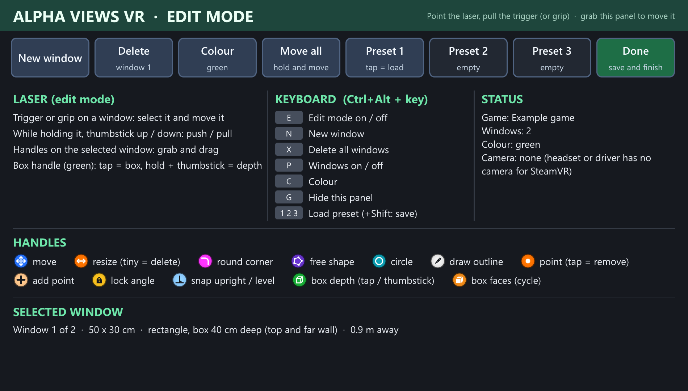
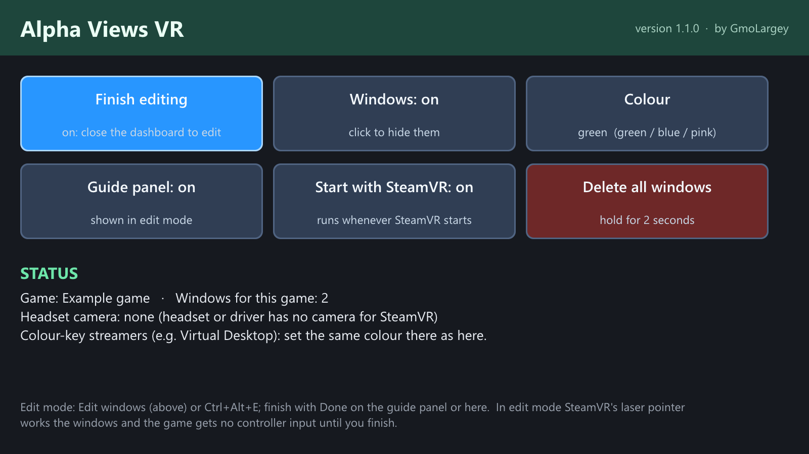

# Alpha Views VR

**See your real room through windows in any SteamVR game.**

Alpha Views VR is a SteamVR overlay app, the SteamVR (OpenVR) companion of
[Alpha Views XR](https://github.com/GmoLargey/Alpha-Views-XR). It places see-through windows over
the game: around your wheel, keyboard, desk or drink. Each window is filled with a solid key colour
(green, blue or pink) that colour-key passthrough streamers such as Virtual Desktop replace with
your real room. On headsets whose camera SteamVR can use (Valve Index, Reverb G2 with the Oasis
driver, ...), a window can show the camera picture instead. It lives in the SteamVR dashboard and
starts with SteamVR.

[Download](https://github.com/GmoLargey/Alpha-Views-VR/releases) · [User guide](packaging/README.txt) · [Building from source](#building-from-source) · [Support me on Ko-fi](https://ko-fi.com/virtuallyreal)

---

## Features

- **Windows:** rectangles with rounded corners, circles, or free shapes you draw in the headset.
  Up to 32 per game, saved per game, with three presets per game.
- **Boxes:** pull a window into a 3D box up to 100 m deep. Each face is drawn where it really is,
  so boxes have real depth. Box modes choose which faces show: the whole box; top and far wall;
  far wall and floor; or everything but the front and floor.
- **Key colour or camera:** green, blue or pink for colour-key streamers, or the headset's own
  camera where SteamVR has one.
- **Edit in the headset:** SteamVR's laser pointer moves, resizes and shapes the windows, with the
  same handles as Alpha Views XR (move, resize, round corners, lock, snap upright / level, free
  shape points, draw). The game gets no controller input while you edit.
- **SteamVR dashboard panel:** edit mode, windows on / off, colour, guide panel, start with
  SteamVR, delete all.
- **Works with every SteamVR game:** it's drawn by SteamVR on top of the game, so no game files
  are touched.

## In the headset

The guide panel in edit mode:



The Alpha Views panel in the SteamVR dashboard:



## Install

Windows 10/11 (64-bit) or Linux (x86-64), with SteamVR.

1. Download `AlphaViewsVR-<version>.zip` (Windows) or `AlphaViewsVR-<version>-linux.tar.gz` (Linux)
   from [Releases](https://github.com/GmoLargey/Alpha-Views-VR/releases) and unpack it somewhere permanent.
2. Start SteamVR.
3. Run `AlphaViewsVR.exe` (Linux: `./AlphaViewsVR`) once. It registers with SteamVR and from then on
   starts with it.

The Linux build needs glibc 2.38 or newer (SteamOS 3.6+, Ubuntu 24.04+, current Arch / Fedora); on
older systems, build it from source.

Open the SteamVR dashboard and choose the Alpha Views icon in the bottom bar. Everything else is in
the [user guide](packaging/README.txt).

## Controls

| In edit mode (laser) | |
|---|---|
| Trigger or grip on a window | select it and move it |
| Thumbstick up / down while holding | push / pull |
| Handles on the selected window | grab and drag |
| Green box handle | tap: box / flat; hold + thumbstick: depth |
| Box faces button | cycle which faces show |
| Pencil (free shapes) | arm, then trace anywhere you point |

| Keyboard, Windows only (Ctrl+Alt +) | |
|---|---|
| E | edit mode on / off |
| N | new window |
| X | delete all windows |
| P | windows on / off |
| C | colour |
| G | guide panel on / off |
| 1 2 3 | load preset (+Shift: save) |

## Limits

SteamVR draws overlays on top of the finished game image and doesn't give them the game's depth.
So unlike Alpha Views XR there are no keep boxes and no hands behind objects: game objects can't
come in front of a window. SteamVR allows 128 overlays per app; round boxes use at most 24 sides.

## Building from source

Windows, Visual Studio 2022 (C++), CMake 3.20 or newer:

```
cmake -S . -B build -A x64
cmake --build build --config Release
```

Linux (x86-64), g++ 9+ or clang, CMake 3.20 or newer:

```
cmake -S . -B build -DCMAKE_BUILD_TYPE=Release
cmake --build build -j
```

The same code runs on both: every picture is drawn on the CPU and handed to SteamVR as a Vulkan
image (the Vulkan loader is opened at run time), and the panel text is drawn with stb_truetype
(Segoe UI on Windows, the desktop's sans-serif font on Linux). CMake downloads the OpenVR SDK
(v2.15.6), Vulkan-Headers, stb_truetype / stb_image_write and, on Linux, DirectXMath into `build/`.
`packaging/package.ps1` builds the Windows zip and the source zip; `packaging/package.sh` builds the
Linux tarball.

## Licence

Copyright (C) 2026 GmoLargey. Free software under the GNU General Public License, version 3
(GPL-3.0-only): see [LICENSE](LICENSE). Uses Valve's OpenVR API (BSD-3-Clause), stb (MIT),
Vulkan-Headers (MIT) and DirectXMath (MIT): see [THIRD_PARTY_NOTICES.txt](packaging/THIRD_PARTY_NOTICES.txt).
